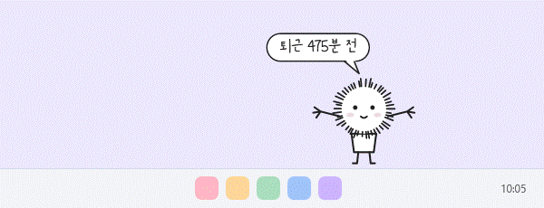
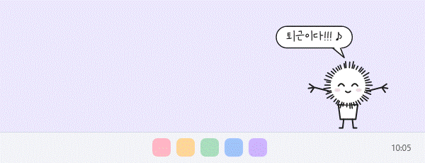
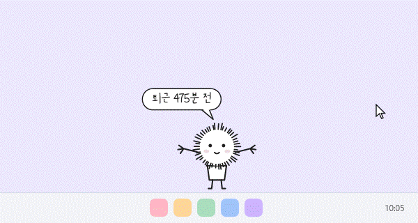
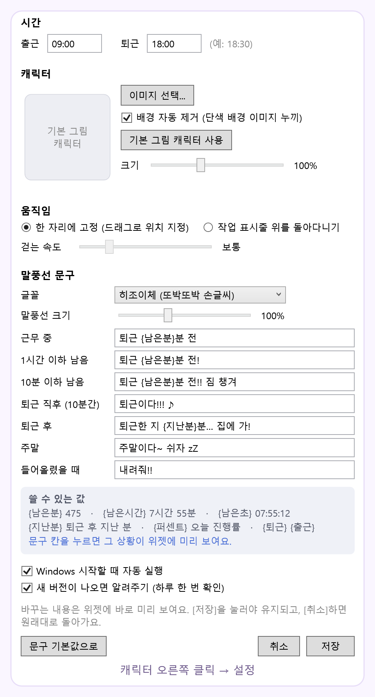

# 🧚 퇴근 요정

**"퇴근까지 몇 분 남았지?"** 
화면 한쪽에서 귀여운 요정이 말풍선으로 쫑알쫑알 알려드려요 ✨

### [🌐 소개 페이지](https://soyoonjeong.github.io/offwork-fairy/) · [⬇️ 다운로드 (최신 버전)](https://github.com/soyoonjeong/offwork-fairy/releases/latest/download/OffWorkFairy.zip)

Windows 10 / 11 · 무료 · 설치 1분

---

## 🌱 이런 요정이에요

- ⏰ 퇴근까지 남은 시간을 **말풍선**으로 알려줘요
- 🔔 퇴근 **10분 전**, 그리고 **퇴근 시간**엔 윈도우 알림까지 똑똑!
- 🎉 퇴근 시간이 되면 신나서 방방 뛰어요
- 🖱️ 마우스를 올리면 정확한 남은 시간과 오늘 진행률(%)이 보여요

## 🚶 작업 표시줄 산책

작업 표시줄 위를 총총총 걸어 다녀요. 가끔 멈춰서 쉬기도 하고, 휙 돌아서 반대로 가기도 해요.

퇴근 시간이 되면? 신나서 **2.5배** 빠르게 뛰어다녀요 🏃💨

## 🙀 들어올리면…

꾹 잡아서 들어올리면 버둥버둥 **"내려줘!!"** 😣 
놓아주면 작업 표시줄로 톡 떨어져서 **"휴~"** 하고 다시 걸어가요.

## 🎨 내 맘대로 꾸미기

캐릭터를 **오른쪽 클릭 → 설정**에서 바꿀 수 있어요. 
바꾸는 내용은 저장하기 전에 위젯에서 바로 미리 보여요 👀

| | |
|---|---|
| 🖼️ **캐릭터 이미지** | 좋아하는 이미지로 바꿔요. 단색 배경은 자동으로 누끼까지! |
| 💬 **말풍선 문구** | 상황별로 마음대로. `{남은분}` `{남은시간}` `{퍼센트}` 같은 값도 쓸 수 있어요 |
| ✏️ **글꼴** | 손글씨 느낌의 귀여운 무료 글꼴 4종 |
| 📏 **크기** | 캐릭터와 말풍선 크기를 따로따로 |
| 🚶 **움직임** | 한 자리에 고정 / 작업 표시줄 산책 (걷는 속도 조절) |

<b>⚙️ 설정 화면 구경하기</b>

## 📦 설치하기

1. **[최신 릴리스](https://github.com/soyoonjeong/offwork-fairy/releases/latest)** 에서 `OffWorkFairy_v*.zip` 을 받아요
2. 압축을 풀고 **`install.cmd`** 를 더블클릭! (관리자 권한 필요 없어요)
3. 화면 오른쪽 아래에 요정이 나타나면 끝 🎉

> 💡 **"Windows의 PC 보호"** 파란 창이 뜨면 **[추가 정보] → [실행]** 을 눌러 주세요. 
> 개인이 만든 프로그램이라 서명이 없어서 뜨는 안내예요.

## 🔄 업데이트

새 버전이 나오면 요정이 먼저 알려줘요! 
캐릭터 **오른쪽 클릭 → [새 버전으로 업데이트]** 한 번이면 끝. 설정이랑 캐릭터는 그대로예요 ✨

## 🗑️ 지우기

Windows **설정 → 앱 → 설치된 앱 → "퇴근 요정" → 제거**

## 📝 참고

- Windows 10 / 11 에서 동작해요. 따로 설치할 건 없어요.
- 포함된 글꼴 — 히조이체 (Heejung Kim), 주아 (우아한형제들), 개구쟁이 (JIKJI SOFT), 나눔손글씨 펜 (NAVER) 
  모두 SIL Open Font License 1.1 이고, 라이선스 전문은 `app\fonts\OFL-*.txt` 에 있어요.
- 직접 넣은 캐릭터 이미지는 개인적으로만 사용해 주세요 🙏

 

**오늘도 수고했어요. 얼른 퇴근해요!** 🏠💨

